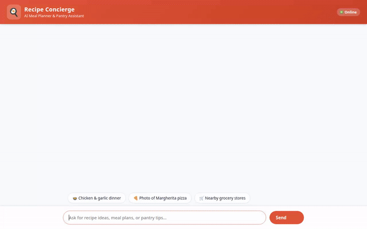

# Recipe Concierge 🍳🤖

An intelligent culinary assistant powered by the Google Agent Development Kit (ADK), Vertex AI Memory Bank, Firestore, Gemini Multimodal models, and Google Maps Platform.



---

## ✨ Features & Architecture

Recipe Concierge is designed to assist home cooks and food enthusiasts with end-to-end recipe discovery, meal planning, dietary safety, media generation, and ingredient sourcing.

### 🧠 Cross-Session Long-Term Memory (Vertex AI Memory Bank)
- **Allergy & Preference Persistence**: Automatically captures, recalls, and enforces dietary restrictions (e.g., peanut, gluten, or dairy allergies) across user conversations using `VertexAiMemoryBankService`.
- **Proactive Safety**: Inspects session memory at the start of every interaction and filters/alerts on conflicting ingredients.

### 🗄️ Database & External Recipe Search
- **Firestore Database Integration**: Fast local queries (`search_recipes`, `get_recipe_details`, `add_recipe`) against a structured Cloud Firestore collection.
- **Online Recipe Fetching**: Dynamic fetching of global recipes via external API integration (`fetch_online_recipes`).

### 🎨 Multimodal Media Generation
- **AI Dish Photos**: Generates high-res dish photography using `gemini-3.1-flash-lite-image` (`generate_recipe_image`), saved as session artifacts and published to Google Cloud Storage.
- **AI Cooking Technique Videos**: Generates short cooking video clips using `gemini-omni-flash-preview` in the `global` region (`generate_recipe_video`), published to Google Cloud Storage.

### 📍 Location & Grocery Sourcing
- **Address Geocoding**: Converts city names or addresses into latitude/longitude coordinates (`geocode_address`).
- **Nearby Places**: Searches nearby supermarkets, bakeries, and grocery stores using Google Maps Places API (`find_nearby_places`).

### 📱 Rich Agent UI (A2UI)
- Native rendering of structured display cards, ingredient lists, and media previews directly in the chat UI.

### 🧮 Recipe Scaling & Python Code Execution
- **Servings Scaler**: Automatically recalculates ingredient quantities for custom serving sizes (`scale_recipe_servings`).
- **Secure Code Sandbox**: Runs custom Python calculations and data analysis within `AgentEngineSandboxCodeExecutor`.

---

## 🛠️ Google Cloud Services Integrated

| Service | Usage in Recipe Concierge |
| --- | --- |
| **Vertex AI Memory Bank** | Manages long-term user memory and dietary profiles |
| **Cloud Firestore** | Stores and queries local recipes and user-submitted dishes |
| **Google Cloud Storage (GCS)** | Hosts generated image and video artifacts with public HTTPS URLs |
| **Vertex AI / Gemini API** | Model inference (`gemini-flash-latest`, `gemini-3.1-flash-lite-image`, `gemini-omni-flash-preview`) |
| **Agent Engine / Agent Runtime** | Hosting environment and Python code sandbox execution |
| **Google Maps Platform** | Geocoding and Places API integration for ingredient sourcing |

---

## 🚀 Local Setup & Development

### Prerequisites
- Python 3.11+
- `uv` package manager (`uv tool install google-agents-cli`)
- Authenticated `gcloud` CLI with a active GCP project (`gcloud auth application-default login`)

### 1. Install Dependencies
```bash
agents-cli install
```

### 2. Run Agent Playground Locally
Start the ADK development web UI to interact with the agent locally:
```bash
agents-cli playground
```

### 3. Run Custom FastAPI Chat Frontend
To run the custom chat frontend locally:
```bash
cd frontend
pip install -r requirements.txt
python main.py
```
*(Open your browser at `http://localhost:8080` once running)*

---

## ☁️ Deployment

Deploy the agent to Google Cloud Agent Runtime:
```bash
gcloud config set project <YOUR_GCP_PROJECT_ID>
agents-cli deploy
```

Deploy the frontend to Cloud Run:
```bash
cd frontend
gcloud run deploy recipe-concierge-frontend \
  --source . \
  --region us-east1 \
  --allow-unauthenticated \
  --set-env-vars AGENT_ENGINE_RESOURCE_NAME="<YOUR_AGENT_RESOURCE_NAME>",AGENT_DIRECTORY="app"
```
